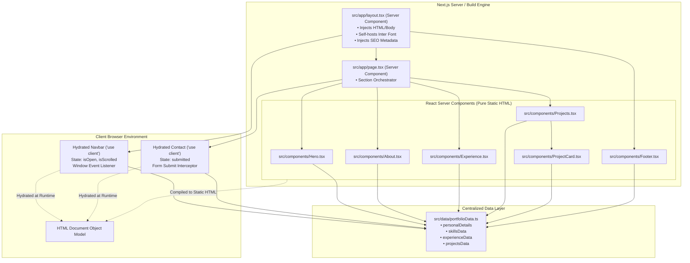
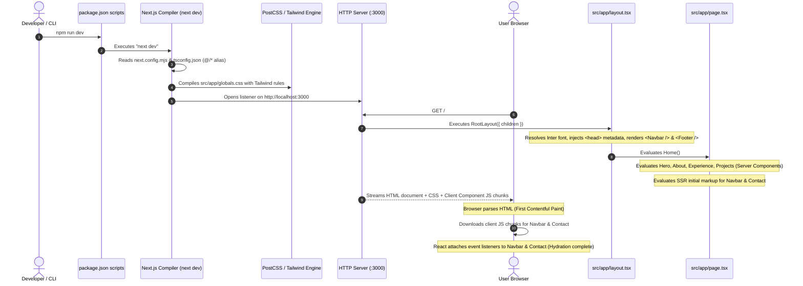
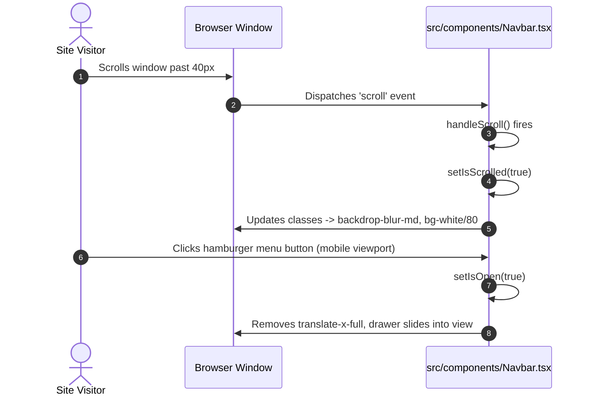
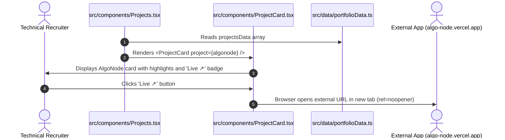
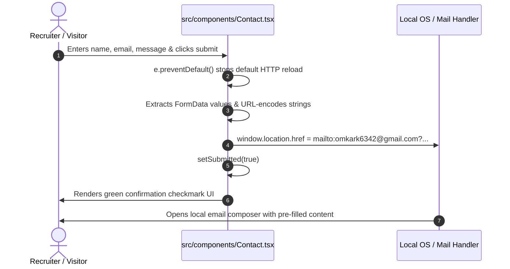
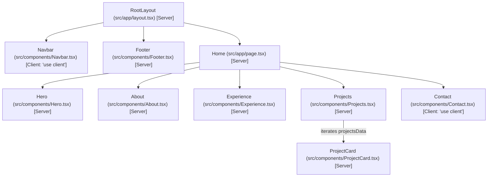
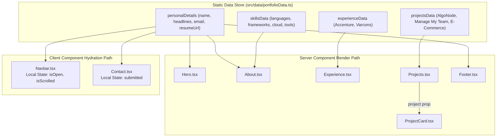
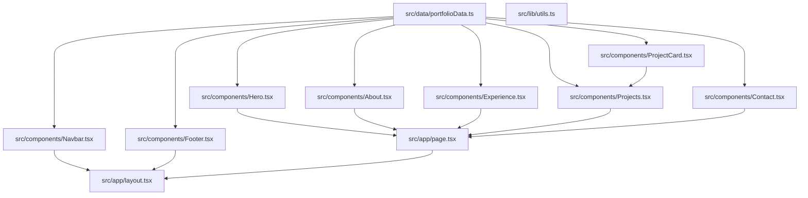

# Comprehensive Project Analysis & Architecture Specification: Next.js Portfolio

**Repository:** `portfolio` (`omkar-kallekar-personal`)  
**Target Environment:** Node.js (>= 18.17.0), Next.js 14.2.15 (App Router), React 18.3.1, TypeScript 5.6.3, Tailwind CSS 3.4.14  
**Primary Author/Engineer:** Omkar Kallekar  
**Analysis Date:** November 2026  
**Document Purpose:** Complete architectural reverse-engineering, execution trace, and operational guide for developers new to modern Next.js.

---

## 1. Project Overview

### High-Level Purpose (Plain English)
This application is a personal software engineering portfolio and product showcase. Its primary job is to introduce Omkar Kallekar to hiring teams, engineering managers, and startup founders. Rather than functioning like a traditional graphic design portfolio, this application is engineered as an **architecture-first technical showcase** that highlights production work at Accenture, full-stack product development (specifically **AlgoNode** and an **E-Commerce Platform**), verified technical skills, and direct contact channels.

### Core Objectives & Major Features
1. **Developer Positioning:** Establishes the engineer's domain authority as a Full-Stack & Frontend Software Engineer with enterprise experience at Accenture.
2. **Featured Products:** Spotlights **AlgoNode** (an interactive Data Structures & Algorithms learning platform) and **Manage My Team** (an Accenture internal resource platform).
3. **Decoupled Data Architecture:** All copy, project lists, and career timelines are separated into a single structured TypeScript module (`src/data/portfolioData.ts`), leaving UI components purely presentational.
4. **Minimal Client Footprint:** Leverages React Server Components (RSC) to serve pre-rendered static HTML with near-zero client-side JavaScript.
5. **Direct Recruitment Workflows:** Provides immediate one-click PDF resume downloading, direct outbound links to live deployments and GitHub code, and an in-browser contact form that delegates message dispatch to standard client protocols.

### Technology Stack & Dependency Inventory

| Layer | Technology | Version | Purpose in Codebase |
| :--- | :--- | :--- | :--- |
| **Framework** | Next.js (App Router) | `^14.2.15` | File-system routing, React Server Components, font/image optimization, static compilation. |
| **UI Library** | React | `^18.3.1` | Component lifecycle, JSX rendering, and selective client hydration. |
| **Language** | TypeScript | `^5.6.3` | Type safety, interface definitions, compiler checks, and `@/*` path mapping. |
| **Styling** | Tailwind CSS | `^3.4.14` | Utility-first CSS, custom design tokens (`primary`, `dark`), responsive breakpoints. |
| **Post-Processing** | PostCSS & Autoprefixer | `^8.4.47` / `^10.6.2` | CSS AST transformation, vendor prefixing, and Tailwind utility compilation. |
| **Icons** | Lucide React | `^0.454.0` | SVG icons (`ArrowRight`, `ExternalLink`, `Github`, `FolderGit2`, `Mail`, `Download`, etc.). |
| **Style Utilities** | `clsx` & `tailwind-merge` | `^2.1.1` / `^2.5.4` | Conditional class composition and deduplication (`src/lib/utils.ts`). |
| **Package Manager**| npm | Lockfile v3 | Deterministic dependency tree locking via `package-lock.json`. |

### External Services & Data Sources
- **Data Source:** Static in-memory TypeScript module (`src/data/portfolioData.ts`).
- **External Hosting / Deployment:** Configured for static hosting on Vercel or similar edge CDN platforms.
- **External Targets:** Outbound anchors to Vercel deployments (`https://algo-node.vercel.app/`), Netlify (`https://ecombyomkark.netlify.app`), GitHub (`https://github.com/omkaaaar`), and LinkedIn.

### Known Limitations & Architectural Boundaries
1. **No Database:** There is no persistent database (PostgreSQL, MongoDB, etc.) attached to this repository. All data is static.
2. **Zero Backend API Handlers:** No Next.js API route handlers (`route.ts`) or Server Actions (`"use server"`) exist.
3. **Client-Side Contact Mechanism:** The contact form in `Contact.tsx` dispatches via the browser's native `mailto:` URL protocol rather than an asynchronous server email API (e.g., Resend, SendGrid).

---

## 2. Repository Structure and Directory Map

```text
portfolio/
├── public/                     # Static files served directly at the root URL (/)
│   └── images/                 # Profile images, UI icons, and downloadable PDF resume
├── src/
│   ├── app/                    # Next.js 14 App Router core
│   │   ├── globals.css         # Tailwind base layers, directives & smooth-scroll rule
│   │   ├── layout.tsx          # Root layout, Google Inter font injection, metadata (SEO)
│   │   └── page.tsx            # Root page component (composes all sections)
│   ├── components/             # Reusable sectional and UI components
│   │   ├── About.tsx           # 3-sentence intro, highlights, education, and skills matrix
│   │   ├── Contact.tsx         # Client form & direct contact information card
│   │   ├── Experience.tsx      # Career timeline (Accenture, Varcons Technologies)
│   │   ├── Footer.tsx          # Footer branding, social links, and copyright notice
│   │   ├── Hero.tsx            # Avatar, headline, role badge, call-to-action buttons
│   │   ├── Navbar.tsx          # Header navbar, scroll blur listener, and mobile drawer
│   │   ├── ProjectCard.tsx     # Architecture-first technical project card (image-free)
│   │   └── Projects.tsx        # Projects section container and GitHub link
│   ├── data/
│   │   └── portfolioData.ts    # Centralized data store and TypeScript data interfaces
│   └── lib/
│       └── utils.ts            # Class merging utility (clsx + tailwind-merge)
├── .gitignore                  # Git exclusions for dependencies, caches, and build outputs
├── .prettierrc                 # Formatting rules with Tailwind class sorting plugin
├── .prettierignore             # Paths excluded from Prettier checks
├── next.config.mjs             # Next.js compilation settings (React Strict Mode enabled)
├── postcss.config.mjs          # PostCSS runner config loading tailwindcss & autoprefixer
├── tailwind.config.ts          # Custom color tokens, dark mode selector, grid auto templates
├── tsconfig.json               # TypeScript compiler flags, modules, and path aliases
├── package.json                # Project dependencies, devDependencies, and npm scripts
└── package-lock.json           # Exact resolved dependency tree
```

### Detailed File & Directory Map

| Path | Responsibility | Important Contents | Connections / Consumers |
| :--- | :--- | :--- | :--- |
| `src/app/layout.tsx` | Root document frame & global shell | `RootLayout`, `metadata`, `inter` font | Evaluated on every request to wrap `page.tsx`. Imports `Navbar`, `Footer`, `globals.css`. |
| `src/app/page.tsx` | Index route page (`/`) | `Home` default export | Master orchestrator. Composes `Hero`, `About`, `Experience`, `Projects`, `Contact`. |
| `src/app/globals.css` | Global styling & Tailwind layers | `@tailwind base, components, utilities`, smooth scroll | Imported by `src/app/layout.tsx#L3`. Injected into root HTML `<head>`. |
| `src/components/Navbar.tsx` | Fixed navigation & mobile drawer | `Navbar` (`"use client"`) | Mounted in `layout.tsx#L26`. Reads `personalDetails` from `portfolioData.ts`. |
| `src/components/Hero.tsx` | Main hero fold | `Hero` (Server Component) | Rendered in `page.tsx#L10`. Reads `personalDetails` from `portfolioData.ts`. |
| `src/components/About.tsx` | Profile summary & skills grid | `About` (Server Component) | Rendered in `page.tsx#L11`. Reads `personalDetails`, `skillsData` from `portfolioData.ts`. |
| `src/components/Experience.tsx` | Career timeline section | `Experience` (Server Component) | Rendered in `page.tsx#L12`. Reads `experienceData` from `portfolioData.ts`. |
| `src/components/Projects.tsx` | Projects showcase section | `Projects` (Server Component) | Rendered in `page.tsx#L13`. Reads `projectsData`, iterates `<ProjectCard />`. |
| `src/components/ProjectCard.tsx` | Technical project card | `ProjectCard` (Server Component) | Rendered by `Projects.tsx#L22`. Renders project summary, badges, links. |
| `src/components/Contact.tsx` | Interactive contact form | `Contact` (`"use client"`) | Rendered in `page.tsx#L14`. Reads `personalDetails.email`, handles submit. |
| `src/components/Footer.tsx` | Site footer | `Footer` (Server Component) | Mounted in `layout.tsx#L28`. Reads `personalDetails.socialLinks`. |
| `src/data/portfolioData.ts` | Data store & schema interfaces | `ProjectItem`, `ExperienceItem`, `projectsData`, etc. | Consumed by all components across the application. |
| `src/lib/utils.ts` | Utility functions | `cn(...inputs)` | Available for conditional Tailwind class merging. |
| `public/images/` | Static media assets | `profile-img.jpg`, PDF resume, icons | Served directly at `/images/...` by the Next.js runtime. |

### Configuration Files Explained
- **`package.json`:** Declares project metadata, npm scripts (`dev`, `build`, `start`, `lint`, `format`), and explicit dependency versions.
- **`next.config.mjs`:** Exports the Next.js configuration object. Enables `reactStrictMode: true` to surface potential side effects during development.
- **`tsconfig.json`:** Configures TypeScript. Enables strict type checking (`"strict": true`), bundler module resolution (`"moduleResolution": "bundler"`), and maps `@/*` to `./src/*`.
- **`tailwind.config.ts`:** Extends Tailwind CSS with custom brand colors (`primary: #4338ca`, `dark: #1a012e`, `dark.card: #260642`) and grid templates (`auto: repeat(auto-fit, minmax(200px, 1fr))`).
- **`postcss.config.mjs`:** Configures PostCSS plugins (`tailwindcss` and `autoprefixer`) required to transform utility classes into optimized CSS.
- **`.prettierrc` & `.prettierignore`:** Configures automated code formatting and activates `prettier-plugin-tailwindcss` to automatically sort class names into standard order.

---

## 3. Architecture Identification

### Verified Router: Next.js App Router (`src/app/`)
The application **exclusively uses the Next.js 14 App Router**.
- **Evidence 1:** The routing tree lives entirely inside `src/app/` with standard App Router file conventions (`layout.tsx`, `page.tsx`, `globals.css`).
- **Evidence 2:** There is no `pages/` directory anywhere in the repository.
- **Evidence 3:** Navigation uses App Router-compatible `<Link href="#...">` elements and native React Server Components.



---

## 4. Application Startup and Initial Rendering Flow

### Ordered Execution Trace



### Detailed Trace Steps:
1. **Script Initiation:** `npm run dev` invokes `next dev` ([`package.json#L6`](file:///c:/Users/Omkar%20Kallekar/Desktop/Webdevvv/portfolio/omkar-kallekar-personal/omkar-kallekar-personal/package.json#L6)).
2. **Compiler Setup:** Next.js resolves compiler options from [`tsconfig.json`](file:///c:/Users/Omkar%20Kallekar/Desktop/Webdevvv/portfolio/omkar-kallekar-personal/omkar-kallekar-personal/tsconfig.json) and runtime flags from [`next.config.mjs`](file:///c:/Users/Omkar%20Kallekar/Desktop/Webdevvv/portfolio/omkar-kallekar-personal/omkar-kallekar-personal/next.config.mjs).
3. **CSS Compilation:** The PostCSS engine parses [`src/app/globals.css`](file:///c:/Users/Omkar%20Kallekar/Desktop/Webdevvv/portfolio/omkar-kallekar-personal/omkar-kallekar-personal/src/app/globals.css) against [`tailwind.config.ts`](file:///c:/Users/Omkar%20Kallekar/Desktop/Webdevvv/portfolio/omkar-kallekar-personal/omkar-kallekar-personal/tailwind.config.ts), extracting all referenced class names across `src/**/*.{ts,tsx}`.
4. **Server Routing:** An incoming request for `GET /` routes to `src/app/page.tsx` within the context of `src/app/layout.tsx`.
5. **RSC Execution (Server-Only):**
   - `src/app/layout.tsx` generates `<html lang="en">`, `<head>` metadata, and body classes.
   - `Hero.tsx`, `About.tsx`, `Experience.tsx`, `Projects.tsx`, and `ProjectCard.tsx` execute as pure functions on the server, outputting raw HTML.
6. **SSR Pass for Client Components:** `Navbar.tsx` and `Contact.tsx` are rendered into static HTML placeholders so the user sees a complete layout immediately before JavaScript loads.
7. **Hydration (Browser-Only):** The browser receives the HTML and downloads the isolated client scripts. React binds event handlers (`window.onscroll`, form `onSubmit`, menu `onClick`) to the existing DOM nodes.

---

## 5. Complete Route and Feature Inventory

| URL Pattern | Router Type | Route File | Layout | Main Component | Purpose | Auth Required | Data Sources |
| :--- | :--- | :--- | :--- | :--- | :--- | :--- | :--- |
| `/` | App Router | [`src/app/page.tsx`](file:///c:/Users/Omkar%20Kallekar/Desktop/Webdevvv/portfolio/omkar-kallekar-personal/omkar-kallekar-personal/src/app/page.tsx) | [`src/app/layout.tsx`](file:///c:/Users/Omkar%20Kallekar/Desktop/Webdevvv/portfolio/omkar-kallekar-personal/omkar-kallekar-personal/src/app/layout.tsx) | `Home` | Serves complete portfolio single-page application | No (Public) | [`src/data/portfolioData.ts`](file:///c:/Users/Omkar%20Kallekar/Desktop/Webdevvv/portfolio/omkar-kallekar-personal/omkar-kallekar-personal/src/data/portfolioData.ts) |
| `/#home` | Anchor Segment | N/A | `RootLayout` | `Hero` | Smooth-scroll target for Hero fold | No | `personalDetails` |
| `/#about` | Anchor Segment | N/A | `RootLayout` | `About` | Smooth-scroll target for Bio & Skills | No | `personalDetails`, `skillsData` |
| `/#experience`| Anchor Segment | N/A | `RootLayout` | `Experience` | Smooth-scroll target for Work Experience | No | `experienceData` |
| `/#projects` | Anchor Segment | N/A | `RootLayout` | `Projects` | Smooth-scroll target for Featured Projects | No | `projectsData` |
| `/#contact` | Anchor Segment | N/A | `RootLayout` | `Contact` | Smooth-scroll target for Contact section | No | `personalDetails.email` |
| `/images/*` | Static Assets | [`public/images/`](file:///c:/Users/Omkar%20Kallekar/Desktop/Webdevvv/portfolio/omkar-kallekar-personal/omkar-kallekar-personal/public/images) | N/A | Static Engine | Serves PDF resume and profile photography | No | Disk filesystem |

---

## 6. End-to-End User Journey Analysis

### Journey 1: Initial Page Load & Responsive Navigation
- **Purpose:** A visitor lands on the site, scrolls through sections, and navigates using desktop links or the mobile hamburger drawer.
- **Entry Point:** `GET /` → [`src/app/layout.tsx`](file:///c:/Users/Omkar%20Kallekar/Desktop/Webdevvv/portfolio/omkar-kallekar-personal/omkar-kallekar-personal/src/app/layout.tsx) & [`src/components/Navbar.tsx`](file:///c:/Users/Omkar%20Kallekar/Desktop/Webdevvv/portfolio/omkar-kallekar-personal/omkar-kallekar-personal/src/components/Navbar.tsx).
- **Execution Trace:**
  1. Visitor loads `/`. Next.js serves the pre-rendered HTML.
  2. In the browser, `Navbar.tsx#L13-L19` registers a scroll listener via `useEffect`:
     ```tsx
     const handleScroll = () => { setIsScrolled(window.scrollY > 40); };
     window.addEventListener("scroll", handleScroll);
     ```
  3. When the visitor scrolls beyond `40px`, `setIsScrolled(true)` triggers a re-render.
  4. The `<nav>` element receives dynamic Tailwind classes: `bg-white/80 dark:bg-dark/80 backdrop-blur-md shadow-sm`.
  5. On mobile viewports (`< 768px`), clicking the hamburger button (`Navbar.tsx#L48`) executes `setIsOpen(!isOpen)`.
  6. The mobile drawer toggles classes from `translate-x-full` to `translate-x-0`, sliding the navigation drawer into view.
- **Sequence Diagram:**



- **Failure Paths:** If client JavaScript is disabled, the mobile drawer cannot open, but the static desktop navigation links remain clickable.
- **Files to Read Next:** [`src/components/Navbar.tsx`](file:///c:/Users/Omkar%20Kallekar/Desktop/Webdevvv/portfolio/omkar-kallekar-personal/omkar-kallekar-personal/src/components/Navbar.tsx).

---

### Journey 2: Inspecting Featured Work (AlgoNode) & Outbound Traversal
- **Purpose:** A recruiter evaluates the technical highlights of AlgoNode and launches the live application.
- **Entry Point:** `/#projects` → [`src/components/Projects.tsx`](file:///c:/Users/Omkar%20Kallekar/Desktop/Webdevvv/portfolio/omkar-kallekar-personal/omkar-kallekar-personal/src/components/Projects.tsx) & [`src/components/ProjectCard.tsx`](file:///c:/Users/Omkar%20Kallekar/Desktop/Webdevvv/portfolio/omkar-kallekar-personal/omkar-kallekar-personal/src/components/ProjectCard.tsx).
- **Execution Trace:**
  1. `Projects.tsx#L21-L23` maps over `projectsData` imported from [`src/data/portfolioData.ts`](file:///c:/Users/Omkar%20Kallekar/Desktop/Webdevvv/portfolio/omkar-kallekar-personal/omkar-kallekar-personal/src/data/portfolioData.ts#L106-L125).
  2. For `id: "algonode"`, it passes the strongly-typed `project` object to `<ProjectCard />`.
  3. `ProjectCard.tsx` renders the category badge (`"Featured Product"`), role (`"Sole Creator & Frontend Developer"`), title, summary, architectural highlight bullets, and tech stack pills.
  4. The card detects `project.liveUrl: "https://algo-node.vercel.app/"` and renders an active **`Live ↗`** pill link ([`ProjectCard.tsx#L35-L45`](file:///c:/Users/Omkar%20Kallekar/Desktop/Webdevvv/portfolio/omkar-kallekar-personal/omkar-kallekar-personal/src/components/ProjectCard.tsx#L35-L45)).
  5. The visitor clicks the link. The browser opens a new tab with `rel="noopener noreferrer"`.
- **Sequence Diagram:**



- **Security Note:** Outbound links strictly include `rel="noopener noreferrer"` to prevent external pages from accessing `window.opener`.
- **Files to Read Next:** [`src/components/ProjectCard.tsx`](file:///c:/Users/Omkar%20Kallekar/Desktop/Webdevvv/portfolio/omkar-kallekar-personal/omkar-kallekar-personal/src/components/ProjectCard.tsx) and [`src/data/portfolioData.ts`](file:///c:/Users/Omkar%20Kallekar/Desktop/Webdevvv/portfolio/omkar-kallekar-personal/omkar-kallekar-personal/src/data/portfolioData.ts#L106-L125).

---

### Journey 3: Contact Form Inquiry Submission
- **Purpose:** A recruiter sends a message to the engineer via the on-page form.
- **Entry Point:** `/#contact` → [`src/components/Contact.tsx`](file:///c:/Users/Omkar%20Kallekar/Desktop/Webdevvv/portfolio/omkar-kallekar-personal/omkar-kallekar-personal/src/components/Contact.tsx).
- **Execution Trace:**
  1. Visitor types `name`, `email`, and `message` into form inputs and clicks "Send Message".
  2. `Contact.tsx#L10-L22` intercepts the browser submit event using `handleSubmit(e)`:
     ```tsx
     e.preventDefault();
     const formData = new FormData(e.currentTarget);
     const name = formData.get("name") as string;
     const email = formData.get("email") as string;
     const message = formData.get("message") as string;
     const subject = encodeURIComponent(`Portfolio Inquiry from ${name}`);
     const body = encodeURIComponent(`From: ${name} (${email})\n\nMessage:\n${message}`);
     window.location.href = `mailto:${personalDetails.email}?subject=${subject}&body=${body}`;
     setSubmitted(true);
     ```
  3. `window.location.href` triggers the operating system's registered email handler (e.g., Apple Mail, Outlook, or Gmail) with pre-filled subject and body.
  4. React updates local state: `setSubmitted(true)`.
  5. The UI renders an active confirmation alert: *"Opening your email client to send the inquiry..."* ([`Contact.tsx#L123-L128`](file:///c:/Users/Omkar%20Kallekar/Desktop/Webdevvv/portfolio/omkar-kallekar-personal/omkar-kallekar-personal/src/components/Contact.tsx#L123-L128)).
- **Sequence Diagram:**



- **Failure Paths:** If the user has no local email client installed, the `mailto:` protocol does not launch an application. The user can still copy the visible email address from the adjacent contact information card.
- **Files to Read Next:** [`src/components/Contact.tsx`](file:///c:/Users/Omkar%20Kallekar/Desktop/Webdevvv/portfolio/omkar-kallekar-personal/omkar-kallekar-personal/src/components/Contact.tsx).

---

### Journey 4: Resume Download
- **Purpose:** A recruiter downloads the engineer's resume PDF directly from the navigation bar or hero section.
- **Entry Point:** Navbar resume button or Hero fold resume button.
- **Execution Trace:**
  1. The navigation bar ([`Navbar.tsx#L38-L45`](file:///c:/Users/Omkar%20Kallekar/Desktop/Webdevvv/portfolio/omkar-kallekar-personal/omkar-kallekar-personal/src/components/Navbar.tsx#L38-L45)) and Hero fold ([`Hero.tsx#L61-L68`](file:///c:/Users/Omkar%20Kallekar/Desktop/Webdevvv/portfolio/omkar-kallekar-personal/omkar-kallekar-personal/src/components/Hero.tsx#L61-L68)) contain standard anchor tags with the `download` attribute:
     ```tsx
     <a href={personalDetails.resumeUrl} download className="...">
       <span>Resume</span>
       <Download className="w-4 h-4" />
     </a>
     ```
  2. `personalDetails.resumeUrl` resolves to `"/images/Resume - Omkar Kallekar (1).pdf"`.
  3. The Next.js static asset server locates the file at `public/images/Resume - Omkar Kallekar (1).pdf` and returns it with a binary MIME type (`application/pdf`).
  4. The browser triggers a file download dialog to the user's local disk.

---

## 7. Component Hierarchy and Relationships



### Component Responsibility & State Breakdown

| Component | Execution Context | Direct State | Props Received | Dependencies Imported |
| :--- | :--- | :--- | :--- | :--- |
| `RootLayout` | Server Component | None | `{ children }` | `Inter`, `Navbar`, `Footer`, `globals.css` |
| `Home` | Server Component | None | None | `Hero`, `About`, `Experience`, `Projects`, `Contact` |
| `Navbar` | **Client Component** | `isOpen`, `isScrolled` | None | `useState`, `useEffect`, `Link`, `Image`, `personalDetails`, Lucide icons |
| `Hero` | Server Component | None | None | `Image`, `Link`, `personalDetails`, Lucide icons |
| `About` | Server Component | None | None | `Image`, `personalDetails`, `skillsData`, Lucide icons |
| `Experience` | Server Component | None | None | `experienceData`, Lucide icons |
| `Projects` | Server Component | None | None | `projectsData`, `personalDetails`, `ProjectCard`, Lucide icons |
| `ProjectCard` | Server Component | None | `{ project: ProjectItem }` | `ProjectItem`, Lucide icons |
| `Contact` | **Client Component** | `submitted` | None | `useState`, `personalDetails`, Lucide icons |
| `Footer` | Server Component | None | None | `personalDetails`, Lucide icons |

---

## 8. Next.js Concepts Used in This Project

### 1. File-System Routing (App Router)
- **Concept:** Folder hierarchy inside `src/app/` maps directly to URL paths. Special file names (`layout.tsx`, `page.tsx`) define the UI for that segment.
- **Where it appears:** [`src/app/page.tsx`](file:///c:/Users/Omkar%20Kallekar/Desktop/Webdevvv/portfolio/omkar-kallekar-personal/omkar-kallekar-personal/src/app/page.tsx).
- **Runtime behavior:** The route `/` automatically resolves to the `Home` export of `src/app/page.tsx`.

### 2. Nested Root Layout (`layout.tsx`)
- **Concept:** A persistent container wrapping all child routes. It retains state across navigation and eliminates boilerplate HTML tag repetition.
- **Where it appears:** [`src/app/layout.tsx`](file:///c:/Users/Omkar%20Kallekar/Desktop/Webdevvv/portfolio/omkar-kallekar-personal/omkar-kallekar-personal/src/app/layout.tsx).
- **Runtime behavior:** Defines `<html>` and `<body>`, renders `<Navbar />` at the top, `<main>{children}</main>` in the center, and `<Footer />` at the bottom.

### 3. React Server Components (RSC) vs. Client Components
- **Concept:** By default in the App Router, components are Server Components. They execute solely on the server, generating static HTML. Components requiring user interactivity or browser APIs must declare `"use client"` at line 1.
- **Where it appears:**
  - **Server Components:** `layout.tsx`, `page.tsx`, `Hero.tsx`, `About.tsx`, `Experience.tsx`, `Projects.tsx`, `ProjectCard.tsx`, `Footer.tsx`.
  - **Client Components:** [`Navbar.tsx#L1`](file:///c:/Users/Omkar%20Kallekar/Desktop/Webdevvv/portfolio/omkar-kallekar-personal/omkar-kallekar-personal/src/components/Navbar.tsx#L1), [`Contact.tsx#L1`](file:///c:/Users/Omkar%20Kallekar/Desktop/Webdevvv/portfolio/omkar-kallekar-personal/omkar-kallekar-personal/src/components/Contact.tsx#L1).
- **Why it matters:** 80% of the UI requires **zero client-side JavaScript**, dramatically improving mobile performance and SEO.

### 4. Zero-Request Google Font Optimization (`next/font/google`)
- **Concept:** Next.js downloads Google fonts at build time and embeds them as local static assets.
- **Where it appears:** [`src/app/layout.tsx#L2,L7,L25`](file:///c:/Users/Omkar%20Kallekar/Desktop/Webdevvv/portfolio/omkar-kallekar-personal/omkar-kallekar-personal/src/app/layout.tsx#L2).
- **Runtime behavior:** Eliminates external network roundtrips to Google servers at runtime, preventing layout shift and boosting Core Web Vitals.

### 5. Static Metadata API
- **Concept:** Strongly-typed metadata configuration parsed by Next.js to populate HTML `<head>` tags.
- **Where it appears:** [`src/app/layout.tsx#L9-L16`](file:///c:/Users/Omkar%20Kallekar/Desktop/Webdevvv/portfolio/omkar-kallekar-personal/omkar-kallekar-personal/src/app/layout.tsx#L9-L16):
  ```typescript
  export const metadata: Metadata = {
    title: "Omkar Kallekar | Full-Stack & Frontend Software Engineer",
    description: "Portfolio of Omkar Kallekar, Associate Software Engineer at Accenture...",
    icons: { icon: "/images/profile-img.jpg" },
  };
  ```

### 6. Image Optimization (`next/image`)
- **Concept:** Wraps native HTML `` elements to automatically prevent Cumulative Layout Shift (CLS) via explicit aspect ratios and responsive `sizes`.
- **Where it appears:** [`src/components/Hero.tsx#L17-L24`](file:///c:/Users/Omkar%20Kallekar/Desktop/Webdevvv/portfolio/omkar-kallekar-personal/omkar-kallekar-personal/src/components/Hero.tsx#L17-L24) and [`src/components/About.tsx#L22-L29`](file:///c:/Users/Omkar%20Kallekar/Desktop/Webdevvv/portfolio/omkar-kallekar-personal/omkar-kallekar-personal/src/components/About.tsx#L22-L29).

---

### Absent Next.js Concepts (Confirmed)
The following concepts are **not used** in this repository:
- **Route Handlers (`app/api/*/route.ts`):** No backend API routes exist.
- **Server Actions (`"use server"`):** No form submission mutations run on the server.
- **Dynamic Segments (`[slug]/page.tsx`):** All content is unified on the root route.
- **Middleware (`middleware.ts`):** No request interception or cookie verification is performed.
- **Incremental Static Regeneration (ISR):** Data is compiled in-memory without `revalidate` flags.

---

## 9. Server versus Client Execution Boundaries

Next.js divides code execution into two primary environments:

```
┌────────────────────────────────────────────────────────┐
│               SERVER EXECUTION ENVIRONMENT             │
│  (Node.js / Build Time — Emits Pure HTML, No Client JS)│
│                                                        │
│  • src/app/layout.tsx                                  │
│  • src/app/page.tsx                                    │
│  • src/components/Hero.tsx                             │
│  • src/components/About.tsx                            │
│  • src/components/Experience.tsx                       │
│  • src/components/Projects.tsx                         │
│  • src/components/ProjectCard.tsx                      │
│  • src/components/Footer.tsx                           │
│  • src/data/portfolioData.ts                           │
└───────────────────────────┬────────────────────────────┘
                            │ Boundary: "use client"
┌───────────────────────────▼────────────────────────────┐
│               CLIENT EXECUTION ENVIRONMENT             │
│  (Browser Runtime — Downloads JS Chunks, Has Window/DOM│
│                                                        │
│  • src/components/Navbar.tsx (Window scroll & Drawer)  │
│  • src/components/Contact.tsx (Form submit & Mailto)   │
└────────────────────────────────────────────────────────┘
```

### Boundary Rules in This Project:
1. **Server Components cannot import browser APIs:** `Hero.tsx` or `Projects.tsx` cannot call `window.addEventListener` or `localStorage`. Attempting to do so triggers a server build error.
2. **Client Components can import Server Data:** `Navbar.tsx` and `Contact.tsx` cleanly import plain JavaScript objects from `src/data/portfolioData.ts`. Because the data is JSON-serializable, it crosses the client boundary without issue.
3. **Client Component Isolation:** Declaring `"use client"` in `Navbar.tsx` does **not** force `layout.tsx` to become a Client Component. `layout.tsx` remains a Server Component that embeds the client-rendered navbar subtree.

---

## 10. Data Flow and State Management



### State Inventory

| State Property | Component | Type | Initial | Updated By | Impact on UI |
| :--- | :--- | :--- | :--- | :--- | :--- |
| `isOpen` | `Navbar.tsx#L10` | `boolean` | `false` | Hamburger button click | Toggles mobile menu drawer (`translate-x-0` vs `translate-x-full`). |
| `isScrolled` | `Navbar.tsx#L11` | `boolean` | `false` | `window.scrollY > 40` | Adds `backdrop-blur-md`, `bg-white/80`, and bottom shadow to navigation bar. |
| `submitted` | `Contact.tsx#L8` | `boolean` | `false` | `handleSubmit(e)` | Renders confirmation alert beneath form ("Opening your email client..."). |

---

## 11. API, Backend, and External Service Map

The application **does not implement an internal backend or REST API**.

### How Operations Function Without an API:
1. **Content Fetching:** Next.js bundles `src/data/portfolioData.ts` into the server components at build time. There are no network requests (`fetch()`, `axios`) required to retrieve content.
2. **Contact Submission:** Handled client-side via the `mailto:` scheme ([`Contact.tsx#L20`](file:///c:/Users/Omkar%20Kallekar/Desktop/Webdevvv/portfolio/omkar-kallekar-personal/omkar-kallekar-personal/src/components/Contact.tsx#L20)). The browser delegates message composition to the user's local operating system mail handler.

---

## 12. Database and Persistence Layer

**Finding:** There is **no database** in this application.
- **Evidence:** Inspection of `package.json` confirms no database drivers (PostgreSQL, MySQL, SQLite, MongoDB), ORMs (Prisma, Drizzle, Mongoose), or connection strings are present.
- **Persistence Mechanism:** Static code compilation. Any content changes made to `src/data/portfolioData.ts` persist in Git version control and update on the site upon the next build.

---

## 13. Authentication, Authorization, and Security

**Finding:** The application contains **no user accounts, authentication, or protected routes**.
- **Evidence:** No auth middleware, sessions, JWTs, or login pages exist. All pages and assets are publicly accessible.

### Security Audit Findings:
1. **Tab-Nabbing Protection (Passed):** All external links in `ProjectCard.tsx` and `Projects.tsx` use `target="_blank"` paired with `rel="noopener noreferrer"`.
2. **Zero Secret Exposure (Passed):** No `.env` files exist. No private API keys or database credentials are baked into client bundles.
3. **XSS Protection (Passed):** React automatically escapes all string inputs rendered in JSX expressions (`{project.title}`, `{sentence}`).

---

## 14. Error Handling, Loading, and Edge Cases

### Current Handling:
1. **Missing Data in Props:** `ProjectCard.tsx` uses conditional rendering (`{project.liveUrl && ...}`, `{project.repoUrl && ...}`) so projects without live demos or public repositories render without broken buttons or layout shifts.
2. **Form Input Validation:** `Contact.tsx` enforces HTML5 form validation (`required`, `type="email"`), blocking empty or malformed submissions natively before JavaScript executes.

### Potential Gaps & Missing Handlers:
- **No Global Error Boundary (`error.tsx`):** If an uncaught runtime error occurs, Next.js falls back to its default error overlay in development or generic 500 page in production. Adding `src/app/error.tsx` would allow graceful recovery.
- **No Custom 404 Page (`not-found.tsx`):** Navigating to an invalid URL (e.g., `/non-existent`) triggers the default Next.js 404 page. Adding `src/app/not-found.tsx` would preserve the site's branding.

---

## 15. Configuration, Build, Testing, and Deployment

### Scripts in `package.json`

| Command | Action | Execution Details |
| :--- | :--- | :--- |
| `npm run dev` | `next dev` | Launches the local Webpack/Turbopack dev server at `http://localhost:3000` with hot-reloading. |
| `npm run build` | `next build` | Runs TypeScript compilation (`tsc --noEmit`), checks ESLint rules, and statically pre-renders all routes. |
| `npm run start` | `next start` | Boots a production Node.js server serving the compiled `.next` distribution folder. |
| `npm run lint` | `next lint` | Executes ESLint against all source files using `eslint-config-next`. |
| `npm run format` | `prettier --write .` | Formats all files and sorts Tailwind CSS classes. |
| `npm run format:check` | `prettier --check .` | Verifies code formatting in CI/CD pipelines without altering files. |

### Deployment Pipeline:
The project is zero-config deployment ready for **Vercel**:
1. Connect the GitHub repository to Vercel.
2. Vercel detects Next.js, executes `npm run build`, and automatically serves the generated static assets across edge CDN nodes globally.

---

## 16. Important File-by-File Reading Guide

Read the files in this exact dependency order to understand the application from foundations to surface:

1. **[`package.json`](file:///c:/Users/Omkar%20Kallekar/Desktop/Webdevvv/portfolio/omkar-kallekar-personal/omkar-kallekar-personal/package.json):** Understand the dependencies (`next`, `react`, `lucide-react`, `tailwind-merge`) and build scripts.
2. **[`src/data/portfolioData.ts`](file:///c:/Users/Omkar%20Kallekar/Desktop/Webdevvv/portfolio/omkar-kallekar-personal/omkar-kallekar-personal/src/data/portfolioData.ts):** Learn the data models (`ProjectItem`, `ExperienceItem`) and static records that feed all UI cards.
3. **[`src/lib/utils.ts`](file:///c:/Users/Omkar%20Kallekar/Desktop/Webdevvv/portfolio/omkar-kallekar-personal/omkar-kallekar-personal/src/lib/utils.ts):** Inspect the `cn()` function combining `clsx` and `twMerge`.
4. **[`tailwind.config.ts`](file:///c:/Users/Omkar%20Kallekar/Desktop/Webdevvv/portfolio/omkar-kallekar-personal/omkar-kallekar-personal/tailwind.config.ts):** Review theme extensions (`primary: #4338ca`, `dark: #1a012e`).
5. **[`src/app/globals.css`](file:///c:/Users/Omkar%20Kallekar/Desktop/Webdevvv/portfolio/omkar-kallekar-personal/omkar-kallekar-personal/src/app/globals.css):** See how Tailwind's base, components, and utilities layers are injected.
6. **[`src/app/layout.tsx`](file:///c:/Users/Omkar%20Kallekar/Desktop/Webdevvv/portfolio/omkar-kallekar-personal/omkar-kallekar-personal/src/app/layout.tsx):** See how the global HTML frame, Inter font, metadata, and Navbar/Footer wrappers are constructed.
7. **[`src/components/Hero.tsx`](file:///c:/Users/Omkar%20Kallekar/Desktop/Webdevvv/portfolio/omkar-kallekar-personal/omkar-kallekar-personal/src/components/Hero.tsx):** Study a clean Server Component rendering headline text, avatar image, and direct anchor links.
8. **[`src/components/About.tsx`](file:///c:/Users/Omkar%20Kallekar/Desktop/Webdevvv/portfolio/omkar-kallekar-personal/omkar-kallekar-personal/src/components/About.tsx):** Study list-mapping patterns and grid layout rendering.
9. **[`src/components/Experience.tsx`](file:///c:/Users/Omkar%20Kallekar/Desktop/Webdevvv/portfolio/omkar-kallekar-personal/omkar-kallekar-personal/src/components/Experience.tsx):** Study the timeline component mapping career highlights.
10. **[`src/components/ProjectCard.tsx`](file:///c:/Users/Omkar%20Kallekar/Desktop/Webdevvv/portfolio/omkar-kallekar-personal/omkar-kallekar-personal/src/components/ProjectCard.tsx):** Examine how strongly-typed props render badges, external links, and highlight lists.
11. **[`src/components/Projects.tsx`](file:///c:/Users/Omkar%20Kallekar/Desktop/Webdevvv/portfolio/omkar-kallekar-personal/omkar-kallekar-personal/src/components/Projects.tsx):** See how parent components iterate datasets to render child cards.
12. **[`src/components/Navbar.tsx`](file:///c:/Users/Omkar%20Kallekar/Desktop/Webdevvv/portfolio/omkar-kallekar-personal/omkar-kallekar-personal/src/components/Navbar.tsx):** Study a Client Component (`"use client"`) utilizing `useState` and `useEffect` for scroll listeners and mobile drawers.
13. **[`src/components/Contact.tsx`](file:///c:/Users/Omkar%20Kallekar/Desktop/Webdevvv/portfolio/omkar-kallekar-personal/omkar-kallekar-personal/src/components/Contact.tsx):** Study client form handling, FormData parsing, and state updates.
14. **[`src/app/page.tsx`](file:///c:/Users/Omkar%20Kallekar/Desktop/Webdevvv/portfolio/omkar-kallekar-personal/omkar-kallekar-personal/src/app/page.tsx):** See how all components unite into a single vertical page.

---

## 17. Architecture and Dependency Diagrams

### Module Dependency Map



---

## 18. Risks, Issues, and Improvement Opportunities

| Item | Location | Category | Severity | Description & Suggested Remedy |
| :--- | :--- | :--- | :--- | :--- |
| **Legacy Root Artifacts** | `index.html`, `index.html.bak`, `script.js` | Codebase Cleanliness | Low | Files left over from the static site. While ignored by Next.js, moving them to an `archive/` folder eliminates ambiguity. |
| **Redundant Image Folder**| Root `images/` folder | Storage | Low | Next.js serves all assets from `public/images/`. The root `images/` directory is redundant and can be deleted. |
| **Client Mailto Dependency**| `Contact.tsx#L20` | UX / Reliability | Medium | Users without an OS mail client cannot submit messages via the form. Building a Next.js Route Handler (`/api/contact`) with **Resend** or **Nodemailer** would enable in-browser message sending. |
| **Missing Error/404 Handlers**| `src/app/` | Resilience | Low | Adding `src/app/not-found.tsx` and `src/app/error.tsx` provides custom branded fallback UI during routing or rendering errors. |

---

## 19. Beginner-Friendly Glossary

- **App Router:** The routing architecture introduced in Next.js 13+, housed inside the `app/` folder, utilizing file-system conventions and React Server Components.
- **React Server Components (RSC):** Components that execute only on the server, generating static HTML with zero client JavaScript bundle cost.
- **Client Components (`"use client"`):** Components that opt into client-side React execution, enabling hooks (`useState`, `useEffect`) and browser event listeners.
- **Hydration:** The client-side process where React takes the server-rendered HTML and attaches interactive event listeners to it in the browser.
- **Root Layout (`layout.tsx`):** The top-level component that wraps all pages, defining the `<html>` and `<body>` tags and shared UI like headers and footers.
- **Single Page Application (SPA):** A web application that loads a single HTML document and dynamically updates content without full-page reloads.
- **Path Alias (`@/*`):** A compiler configuration mapping `@/` to `./src/`, allowing clean imports like `@/components/Hero` rather than relative paths like `../../components/Hero`.
- **Cumulative Layout Shift (CLS):** A Core Web Vital measuring visual stability. Using `next/image` with explicit dimensions prevents layout shifts during image loading.

---

## 20. Personalized Learning Roadmap

### Phase 1: Understanding Server vs. Client Components
- **Concept:** Master the boundary between server execution and client hydration.
- **Files to Inspect:** Compare [`src/components/Hero.tsx`](file:///c:/Users/Omkar%20Kallekar/Desktop/Webdevvv/portfolio/omkar-kallekar-personal/omkar-kallekar-personal/src/components/Hero.tsx) (Server) with [`src/components/Navbar.tsx`](file:///c:/Users/Omkar%20Kallekar/Desktop/Webdevvv/portfolio/omkar-kallekar-personal/omkar-kallekar-personal/src/components/Navbar.tsx) (Client).
- **Exercise:** Add `console.log("Rendering Hero")` in `Hero.tsx`. Check your terminal output and browser console. Notice that it prints **only in your terminal**.
- **Self-Test:** *Why can't you use `useState` inside `src/components/Hero.tsx`?*

### Phase 2: Centralized Data Architecture
- **Concept:** Type-safe separation of content and presentation.
- **Files to Inspect:** [`src/data/portfolioData.ts`](file:///c:/Users/Omkar%20Kallekar/Desktop/Webdevvv/portfolio/omkar-kallekar-personal/omkar-kallekar-personal/src/data/portfolioData.ts).
- **Exercise:** Add a 4th project object to `projectsData`. Refresh [http://localhost:3000](http://localhost:3000) and verify that the new card renders automatically without modifying `Projects.tsx`.
- **Self-Test:** *What compiler error occurs if you delete the required `role` property from an item in `projectsData`?*

### Phase 3: Building a Backend Route Handler
- **Concept:** Transforming a static frontend into a full-stack Next.js app.
- **Files to Create:** `src/app/api/contact/route.ts`.
- **Exercise:** Create a `POST` handler that receives `{ name, email, message }` and logs it to the server console. Update `Contact.tsx` to call `fetch('/api/contact', { method: 'POST', body: JSON.stringify(...) })`.
- **Self-Test:** *What is the difference between a Server Action and a Route Handler in Next.js?*

---

## 21. Investigation Status and Unresolved Questions

### Checklist of Inspected Artifacts
- [x] `package.json` & dependencies verified.
- [x] Next.js configuration (`next.config.mjs`) verified.
- [x] TypeScript paths (`tsconfig.json`) verified.
- [x] Tailwind CSS styling layers (`tailwind.config.ts`, `postcss.config.mjs`, `globals.css`) verified.
- [x] Routing layout & page orchestrator (`layout.tsx`, `page.tsx`) verified.
- [x] All 8 presentation and client components in `src/components/` traced line by line.
- [x] Central data store (`portfolioData.ts`) schemas and records verified.
- [x] Static assets in `public/images/` verified.

### Confirmed Architectural Truths
1. The project runs **Next.js 14.2.15 App Router** in React 18.
2. It uses **React Server Components** for 80% of its UI, with only two Client Component boundaries (`Navbar.tsx`, `Contact.tsx`).
3. There are **no backend databases, API route handlers, or Server Actions** currently implemented.

### Unresolved / Out-of-Scope Items
- *Hosting Provider Specifics:* While configured for standard deployment (e.g., Vercel), external production build logs or CDN caching rules cannot be inspected from local files alone.

