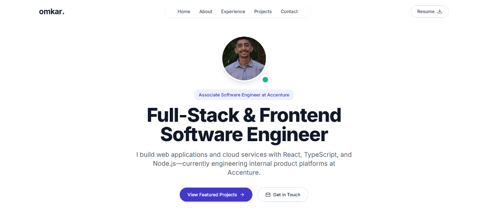

# Omkar Kallekar — Portfolio

> Full-Stack & Frontend Software Engineer · React · TypeScript · Node.js · GCP

**Live site:** https://omkar-kallekar.vercel.app/

---

## Screenshot



---

## Tech Stack

| Technology | Why |
|---|---|
| **Next.js 14 (App Router)** | Server components, file-based routing, and built-in image optimisation out of the box |
| **TypeScript** | Catches type errors at compile time; keeps the single data file safe to edit |
| **Tailwind CSS** | Utility-first styling — no separate CSS files to maintain |
| **Lucide React** | Consistent, tree-shakeable icon set |
| **Vercel** | Zero-config deployment with automatic preview URLs on every push |

---

## Features

- Single-page portfolio with smooth scroll navigation
- Responsive layout — works at 360 px and up
- Dark-mode ready (Tailwind `dark:` classes; system preference via CSS)
- All content lives in one typed file (`src/data/portfolioData.ts`) — no CMS needed
- Contact section with copy-to-clipboard email and LinkedIn link (no form, no fake success state)
- Open Graph and Twitter Card metadata for link previews
- Custom 404 and error boundary pages

---

## Project Structure

```
src/
├── app/
│   ├── layout.tsx        # Root layout — metadata, fonts, Navbar, Footer
│   ├── page.tsx          # Home page — assembles all sections
│   ├── globals.css       # Tailwind base + custom CSS variables
│   ├── not-found.tsx     # 404 page
│   └── error.tsx         # Error boundary (client component)
├── components/
│   ├── Navbar.tsx        # Sticky nav with mobile drawer + Escape key close
│   ├── Hero.tsx          # Landing section with CTA and resume download
│   ├── About.tsx         # Bio, highlight cards, skills matrix
│   ├── Experience.tsx    # Timeline of work experience
│   ├── Projects.tsx      # Project grid
│   ├── ProjectCard.tsx   # Individual project card
│   ├── Contact.tsx       # Copy-email + mailto + LinkedIn links
│   └── Footer.tsx        # Footer
└── data/
    └── portfolioData.ts  # ← Edit this file to update all content
public/
└── images/               # Static assets and resume PDF
```

---

## Getting Started

**Requirements:** Node.js `>=22.0.0`

```bash
# Install dependencies
npm install

# Start dev server
npm run dev

# Type-check (no emit)
npx tsc --noEmit

# Lint
npm run lint

# Production build
npm run build

# Format with Prettier
npm run format
```

---

## How to Edit Content

**All site content lives in [`src/data/portfolioData.ts`](./src/data/portfolioData.ts).**

| Export | What it controls |
|---|---|
| `personalDetails` | Name, role, bio sentences, email, location, resume URL, social links |
| `skillsData` | Four skill categories: languages, frontend, backendAndCloud, tools |
| `experienceData` | Work history — company, role, period, bullet highlights |
| `projectsData` | Project cards — title, summary, stack, links, highlights |

No other files need to change for content updates.

---

## Deployment

The site deploys automatically to **Vercel** on every push to `main`.

**First-time setup:**
1. Import the GitHub repo at [vercel.com/new](https://vercel.com/new)
2. Framework preset: **Next.js** (auto-detected)
3. Leave Output Directory blank (Next.js outputs to `.next` by default)
4. Node.js version: set to **22.x or 26.x** in Project Settings → General

Every push to `main` triggers a production deployment. Pull requests get a preview URL automatically.

---

## Design Decisions

- **Single typed data file, no CMS** — for a portfolio this size, a CMS adds deployment complexity with no benefit. Editing `portfolioData.ts` is fast and type-safe.
- **No contact form** — a `mailto:` form that fires `window.location.href` and shows a success state even before the email client opens is misleading UX. Direct links (copy email, mailto, LinkedIn) are honest and more reliable across all devices.
- **Two project cards, not three** — a smaller set of strong, accurate descriptions is better than padding with weaker entries.
- **`"use client"` only where needed** — `Navbar` (scroll + mobile drawer state), `Contact` (clipboard API). All other components are Server Components.

---

## Known Limitations & What I'd Improve Next

- **No OG image** — the `openGraph` metadata block is set but there is no custom social preview image yet. Adding a `opengraph-image.png` to `src/app/` would complete this.
- **Dark mode toggle** — the site respects system preference via CSS but has no manual toggle button.
- **No analytics** — would add Vercel Analytics or Plausible in a future iteration.
- **Resume hosted in `/images/`** — ideally the PDF would sit at `/omkar-kallekar-resume.pdf` (public root) for a cleaner URL.

---

## Contact

- **Email:** omkark6342@gmail.com
- **LinkedIn:** https://linkedin.com/in/omkar-kallekar

